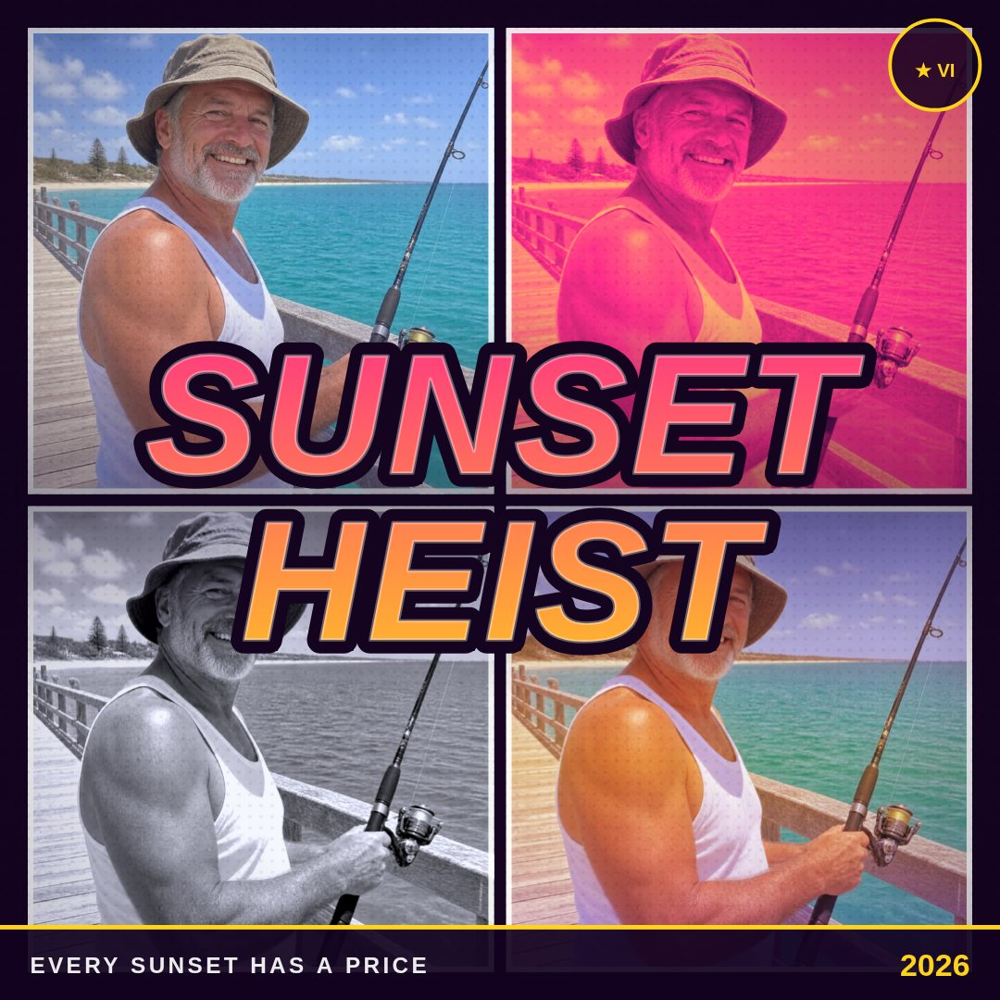

# VICE HEAT — Cover Art Studio

[](https://make.fun/bounty/gta6-cover-art-01?utm_source=github&utm_medium=readme&utm_campaign=gta6-cover-art-01)
[](https://make.fun/bounty/gta6-cover-art-01/leaderboard?utm_source=github&utm_medium=readme&utm_campaign=gta6-cover-art-01)
[](https://make.fun/bounty/gta6-cover-art-01?utm_source=github&utm_medium=readme&utm_campaign=gta6-cover-art-01)

Entry for the [make.fun](https://make.fun) bounty [gta6-cover-art-01](https://make.fun/bounty/gta6-cover-art-01) — "Make GTA 6 Cover Art".

Turn any photo + caption into a multi-panel GTA-style poster cover — **100% offline, in the browser**. No uploads, no server, no tracking. Photos never leave your machine.



## What it does

Upload 1–6 photos and get a poster-style cover: a grid of panels, each with a
different color treatment, giant outlined gradient lettering across the middle,
and a tagline strip with the year — then export a print-ready PNG.

## How to use

1. Serve the app (or just open it):
   ```sh
   node serve.ts        # → http://localhost:8080
   ```
   It also works by opening `app/index.html` directly from disk.
2. **Choose photos** (file picker or drag & drop, multi-file). Click a thumbnail
   to assign it to the selected panel. With no photos at all, the cover shows
   procedural art (striped sun, palm silhouettes, skyline) — it already looks
   finished before you upload anything.
3. Click a panel to select it, then **drag inside it** to reposition the photo,
   scroll to zoom, or use the Zoom / Rotate / Flip controls.
4. Pick a **layout** (2×2, 1×2, 1×3, 2×3), a **palette** (Vice sunset / Neon
   night), and edit the **title, tagline, text color and position**.
5. **🎲 Randomize style** when you want a fast new look.
6. Choose an export size and hit **Export PNG** — the file downloads as
   `cover-art-<timestamp>.png`.

## Features

- **Multi-panel cover engine** — 2–6 panels, each with its own treatment:
  full color, duotone pink-orange, high-contrast noir, sunset wash.
- **Vice City grade** — magenta → orange → dark-purple sunset gradients (or
  neon night: dark blue + pink glow), light halftone dots + film grain for a
  print look, vignette.
- **Big poster lettering** — two-line custom title, thick outline, pink-yellow
  gradient fill, hard drop shadow. System fonts only (no webfonts, no official
  fonts). Bottom strip with tagline + `2026` and a ★ VI badge.
- **Real editor** — per-panel zoom / pan / rotate / flip / border toggle,
  photo tray with click-to-assign, drag & drop anywhere, live redraw on every
  input.
- **Procedural default art** — palm silhouettes, striped sun, skyline and sea
  streaks drawn on canvas per panel (seeded, so every panel differs).
- **Export sizes** — 1200×675 (X), 1080×1080 (square), 1080×1350 (portrait),
  1600×900 (desktop). Every effect is rendered into the final PNG.
- **Screenshot scenes** — `?shot=cover` shows the cover alone,
  `?shot=editor` the full editor; `?photo=<sample>&caption=<text>` pick the
  demo photo and title. `window.__shotReady` fires once the scene has painted.

## Tech

Vanilla JS + Canvas 2D, no frameworks, no network requests at all
(`app/` contains only `index.html`, `style.css`, `src/engine.js`,
`src/studio.js` and two sample photos). Key functions: `renderPanel()`,
`renderTitle()`, `renderCover()`, `exportPNG()` in `src/engine.js`.

## License

MIT — see [LICENSE](LICENSE). All visuals are original procedural canvas art;
no Rockstar logos, artwork, characters or fonts are used anywhere.
